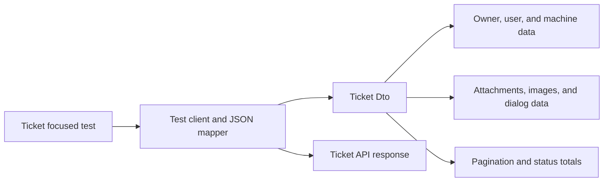
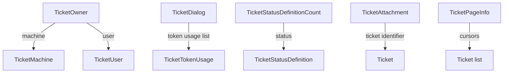
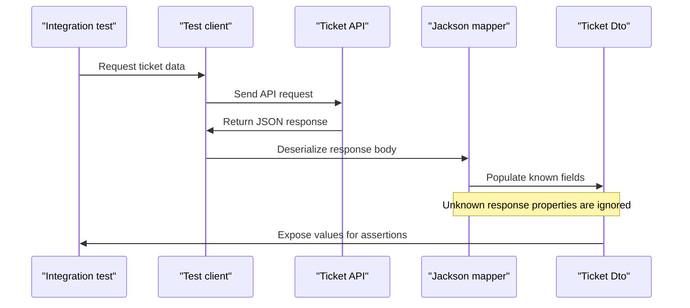

# Ticket Dto

Ticket Dto is a group of Jackson-ready Java data-transfer objects used by the OpenFrame test service to deserialize and inspect ticket-related API results. It provides small, composable representations of ticket attachments, dialog telemetry, images, owners, associated users and machines, cursor pagination, and status totals.

The module is supplied by the `com.openframe.oss:openframe-test-service-core` artifact from the OpenFrame OSS Library and runs as part of this repository's OpenFrame test service. It is a test-facing contract layer: it models response data but does not make requests, persist data, or implement ticket workflow rules.

## Design Goals

- **Tolerant contract parsing:** Every DTO uses `@JsonIgnoreProperties(ignoreUnknown = true)`, allowing test clients to accept server responses that add fields without immediately breaking deserialization.
- **Convenient fixture construction:** Lombok generates accessors, value methods, no-argument and all-argument constructors, and builders for every DTO.
- **Focused composition:** Nested types express ticket ownership and dialog usage without duplicating machine or user fields.
- **Boundary-oriented models:** The DTOs retain identifiers, names, URLs, timestamps, cursors, and counts as received values rather than applying business logic.

## Architecture Overview

Ticket Dto is a consumer-side response model. The ticket API response is deserialized into these objects, and test code can then make assertions against the resulting fields. The module does not define API endpoints or test cases itself.

## Component Map

| Area | Components | Responsibility |
|---|---|---|
| Content metadata | `TicketAttachment`, `TicketImage` | Represents an uploaded attachment's metadata and an image URL. |
| Dialog telemetry | `TicketDialog`, `TicketTokenUsage` | Models a dialog's mode and per-chat token-use measurements. |
| Ownership and context | `TicketOwner`, `TicketMachine`, `TicketUser` | Represents an owner as either machine- or user-oriented data, with optional nested detail. |
| List navigation and summaries | `TicketPageInfo`, `TicketStatusDefinitionCount` | Carries cursor pagination state and a count associated with a ticket status definition. |

## Data Relationships

`TicketStatusDefinition` is a supporting ticket DTO referenced by `TicketStatusDefinitionCount`; its definition is outside the provided Ticket Dto core component set. Similarly, `Ticket` and a ticket-list envelope are response concepts rather than classes supplied by this module.

## Core DTOs

### TicketAttachment

[TicketAttachment source](https://github.com/flamingo-stack/openframe-oss-lib/blob/7a766f00e4f58b5d89db007b878ac8d6e0c344f4/openframe-test-service-core/src/main/java/com/openframe/test/data/dto/ticket/TicketAttachment.java)

`TicketAttachment` represents attachment metadata, not attachment bytes. Its fields identify the attachment and parent ticket, describe the uploaded file, and record who uploaded it and when.

| Field | Type | Meaning |
|---|---|---|
| `id` | `String` | Attachment identifier. |
| `ticketId` | `String` | Identifier of the associated ticket. |
| `fileName` | `String` | Original or displayed filename. |
| `contentType` | `String` | Media type reported for the file. |
| `fileSize` | `Long` | File size. The unit is not specified by this DTO. |
| `uploadedAt` | `Instant` | Upload timestamp. |
| `uploadedBy` | `String` | Identifier of the uploading actor. |

### TicketImage

[TicketImage source](https://github.com/flamingo-stack/openframe-oss-lib/blob/7a766f00e4f58b5d89db007b878ac8d6e0c344f4/openframe-test-service-core/src/main/java/com/openframe/test/data/dto/ticket/TicketImage.java)

`TicketImage` is the minimal image representation: `imageUrl` holds the location supplied by the response. URL fetching, authentication, validation, and image parsing remain the responsibility of the caller or HTTP client.

### TicketDialog and TicketTokenUsage

[TicketDialog source](https://github.com/flamingo-stack/openframe-oss-lib/blob/7a766f00e4f58b5d89db007b878ac8d6e0c344f4/openframe-test-service-core/src/main/java/com/openframe/test/data/dto/ticket/TicketDialog.java) · [TicketTokenUsage source](https://github.com/flamingo-stack/openframe-oss-lib/blob/7a766f00e4f58b5d89db007b878ac8d6e0c344f4/openframe-test-service-core/src/main/java/com/openframe/test/data/dto/ticket/TicketTokenUsage.java)

`TicketDialog` identifies a dialog, exposes its `currentMode`, and contains a list of `TicketTokenUsage` records. Each usage record separates `inputTokensSize`, `outputTokensSize`, `totalTokensSize`, and `contextSize` for a `chatType`. The DTOs only expose observed values; they do not calculate totals or impose token limits.

### TicketOwner, TicketMachine, and TicketUser

[TicketOwner source](https://github.com/flamingo-stack/openframe-oss-lib/blob/7a766f00e4f58b5d89db007b878ac8d6e0c344f4/openframe-test-service-core/src/main/java/com/openframe/test/data/dto/ticket/TicketOwner.java) · [TicketMachine source](https://github.com/flamingo-stack/openframe-oss-lib/blob/7a766f00e4f58b5d89db007b878ac8d6e0c344f4/openframe-test-service-core/src/main/java/com/openframe/test/data/dto/ticket/TicketMachine.java) · [TicketUser source](https://github.com/flamingo-stack/openframe-oss-lib/blob/7a766f00e4f58b5d89db007b878ac8d6e0c344f4/openframe-test-service-core/src/main/java/com/openframe/test/data/dto/ticket/TicketUser.java)

`TicketOwner` accommodates two ownership forms. Its `type` signals the response's ownership kind; `machineId` and `machine` carry machine ownership data, while `userId` and `user` carry user ownership data. The class does not enforce mutual exclusivity, so tests should assert the combination that their expected API response requires.

`TicketMachine` provides the persisted record `id`, the domain-facing `machineId`, `hostname`, and `organizationId`. `TicketUser` provides `id`, `firstName`, and `lastName`. These narrow views avoid coupling ticket assertions to broader device or user response objects.

### TicketPageInfo

[TicketPageInfo source](https://github.com/flamingo-stack/openframe-oss-lib/blob/7a766f00e4f58b5d89db007b878ac8d6e0c344f4/openframe-test-service-core/src/main/java/com/openframe/test/data/dto/ticket/TicketPageInfo.java)

`TicketPageInfo` models cursor navigation for ticket lists:

- `hasNextPage` and `hasPreviousPage` indicate whether adjacent result pages are available.
- `startCursor` and `endCursor` delimit the returned result window.

It contains no page-loading behavior. A test client uses the values to form and validate a subsequent request according to the relevant API contract.

### TicketStatusDefinitionCount

[TicketStatusDefinitionCount source](https://github.com/flamingo-stack/openframe-oss-lib/blob/7a766f00e4f58b5d89db007b878ac8d6e0c344f4/openframe-test-service-core/src/main/java/com/openframe/test/data/dto/ticket/TicketStatusDefinitionCount.java)

`TicketStatusDefinitionCount` pairs a `TicketStatusDefinition` with an `Integer` `count`. It is suitable for validating grouped ticket summaries, such as totals by status. The DTO does not calculate, normalize, or validate counts.

## Deserialization and Test Flow

The generated Lombok builder is useful when a test needs to construct an expected value or fixture. For example, `TicketUser.builder()` can create a concise expected user projection. Whether equality assertions are appropriate depends on the surrounding response model and test intent.

## Compatibility and Maintenance Notes

- Adding a field to the upstream response is intentionally forward-compatible for these DTOs because unknown JSON properties are ignored.
- Renaming, removing, or changing the JSON representation of an existing field can still break tests that depend on it.
- `Instant`, numeric token sizes, file size, and counts may deserialize as `null` when the API omits them; the DTO classes impose no non-null constraints.
- `TicketOwner` is a flexible response container, not a validated ownership union. Check `type` and the expected identifier or nested projection explicitly in tests.
- The code is maintained in the OpenFrame OSS Library. Use the linked source files when changing contract expectations; this tenant repository consumes the library artifact at its pinned dependency version.
