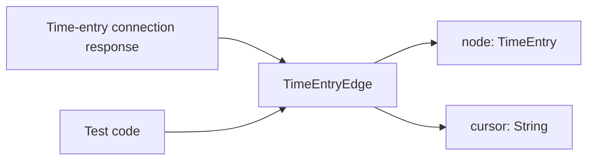
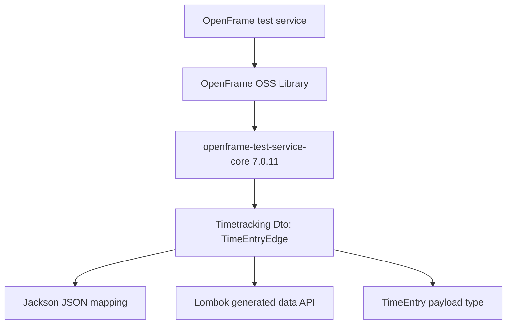
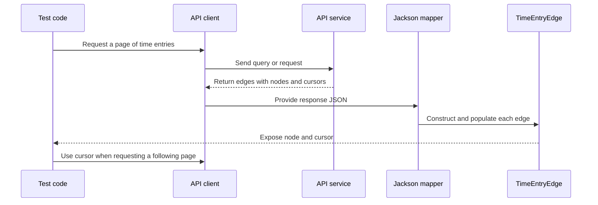

# Timetracking Dto

Timetracking Dto provides the `TimeEntryEdge` test-data contract used to deserialize and navigate a cursor-based collection of time-entry records. It belongs to the test-support library consumed by this repository's OpenFrame test service, rather than to a production runtime service. The type combines one time-entry payload with the cursor that identifies its position in a result set.

The implementation is supplied by the OpenFrame OSS Library artifact `com.openframe.oss:openframe-test-service-core` at version `7.0.11`. Its authoritative source is [TimeEntryEdge.java](https://github.com/flamingo-stack/openframe-oss-lib/blob/7a766f00e4f58b5d89db007b878ac8d6e0c344f4/openframe-test-service-core/src/main/java/com/openframe/test/data/dto/timetracking/TimeEntryEdge.java).

## Purpose and Scope

`TimeEntryEdge` is a lightweight Java data-transfer object in the `com.openframe.test.data.dto.timetracking` package. It models an individual edge in a connection-style response:

- `node` holds the associated `TimeEntry` object.
- `cursor` holds the opaque pagination position for that object.

The class does not query, persist, validate, or calculate time entries. Its responsibility is limited to representing a response item faithfully after JSON deserialization and making that data convenient for test code to inspect.

## Structure



The edge separates the business object from its pagination metadata. A test can assert time-entry fields through `node` and retain `cursor` for a subsequent page request without conflating those concerns.

## Component Contract

| Element | Type | Role |
|---|---|---|
| `TimeEntryEdge` | Java class | A deserializable test-side representation of one connection edge. |
| `node` | `TimeEntry` | The time-entry payload associated with the edge. The definition of `TimeEntry` is outside the supplied Timetracking Dto component. |
| `cursor` | `String` | The server-provided cursor identifying this edge's position in the paginated sequence. |

The class uses Lombok annotations to generate the conventional data-object API:

- `@Data` supplies accessors, mutators, and value-oriented methods.
- `@Builder` supports explicit, readable construction in tests.
- `@NoArgsConstructor` supports frameworks that need an empty constructor.
- `@AllArgsConstructor` supports direct construction with both fields.

`@JsonIgnoreProperties(ignoreUnknown = true)` makes deserialization forward-compatible with additional response fields. Tests can consume the fields they understand while tolerating unrelated fields added by the server.

## Dependency Architecture



At compile time, the Java source directly depends on Jackson annotations, Lombok annotations, and the `TimeEntry` model in the same timetracking package. At runtime in tests, Jackson uses the no-argument construction and generated mutators to populate the edge from a response payload.

## Deserialization and Pagination Flow



The module preserves the cursor as received. It does not interpret cursor contents, generate cursors, or determine whether another page exists. Those policies belong to the surrounding API contract and test flow.

## Construction Patterns

Tests may obtain an instance through JSON mapping or construct one directly. The builder is useful when a test only needs to specify the payload and pagination position relevant to its assertion.

```java
TimeEntryEdge edge = TimeEntryEdge.builder()
    .node(timeEntry)
    .cursor("next-page-position")
    .build();
```

The literal cursor above is illustrative only. Production-facing tests should treat cursors returned by the service as opaque values and avoid relying on their internal format.

## Maintenance Guidance

- Preserve the `node` and `cursor` field names unless the upstream response contract changes in a coordinated way.
- Keep unknown JSON properties ignored when compatibility with evolving server responses is required.
- Do not add domain behavior, persistence concerns, or pagination policy to this object; it is intentionally a narrow transport contract.
- When adding fields to assertions, verify that the corresponding payload model and API response expose them rather than inferring them from cursor metadata.
- Changes to the source should be made in the OpenFrame OSS Library, because this repository consumes the module as a versioned dependency.

## Boundaries

Timetracking Dto represents one item in a time-entry result collection. The module does not define the time-entry payload itself, execute time-tracking operations, expose an HTTP endpoint, or provide repository access. It is a test-contract layer that helps higher-level time-tracking tests traverse paginated responses predictably.
