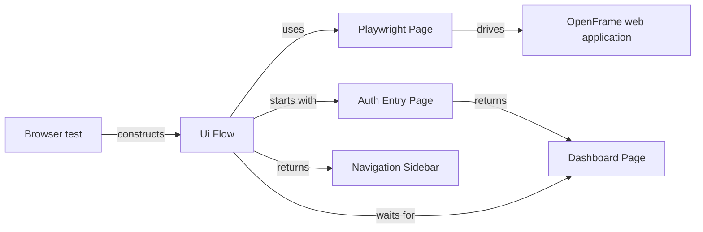
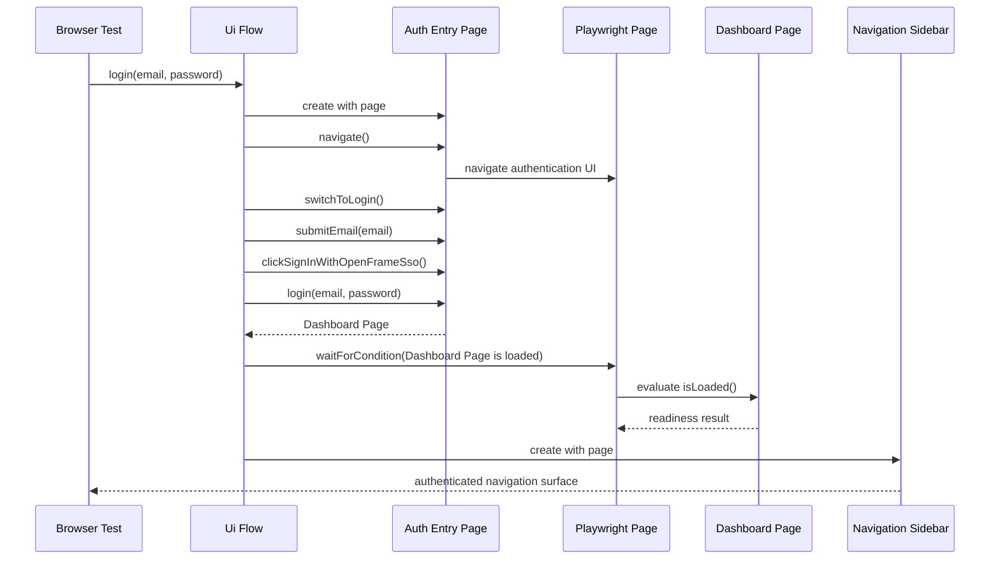
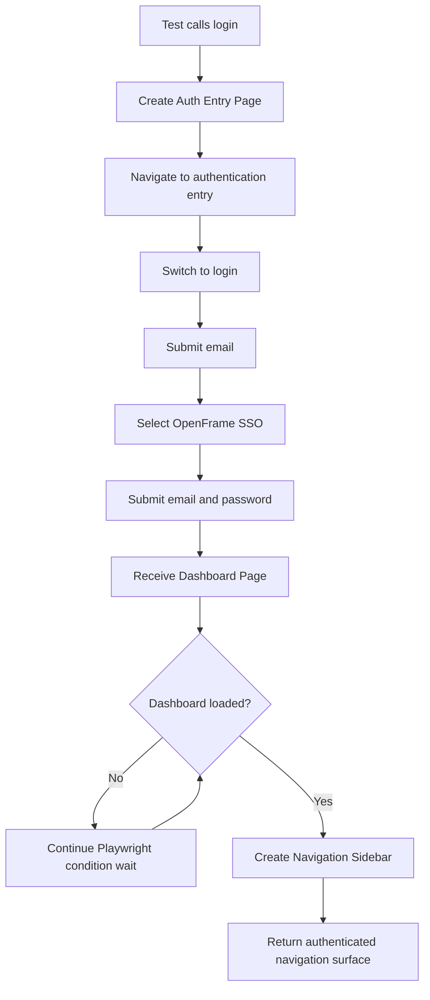

# Ui Flow

Ui Flow is a small Playwright page-object workflow from the OpenFrame Test Service Core library. It centralizes the interactive OpenFrame SSO sign-in path used by browser-based tests: navigate to the authentication entry point, select the login route, submit the email address, select OpenFrame SSO, provide credentials, wait for the dashboard readiness predicate, and hand the test a navigation object for the authenticated application.

This repository runs the library as part of its `openframe/services/openframe-test` service. The implementation is supplied by OpenFrame OSS Library version `7.0.11`; its published source is [UILoginFlow.java](https://github.com/flamingo-stack/openframe-oss-lib/blob/7a766f00e4f58b5d89db007b878ac8d6e0c344f4/openframe-test-service-core/src/main/java/com/openframe/test/pages/flow/UILoginFlow.java).

## Purpose and Contract

`UILoginFlow` accepts a Playwright `Page` when constructed. Its `login(email, password)` operation owns the authentication transition and returns a fresh `NavigationSidebar` bound to the same page.

The method's completion boundary is important: it does not return immediately after credential submission. It calls Playwright `waitForCondition` with `DashboardPage.isLoaded`, so callers receive the sidebar only after the dashboard reports itself loaded. The flow does not expose the `DashboardPage`; navigation after authentication is deliberately represented through `NavigationSidebar`.

| Input or output | Role |
| --- | --- |
| Playwright `Page` | Shared browser document and synchronization surface. |
| `email` | Submitted first to the authentication entry page and then passed to the SSO login step. |
| `password` | Passed only to the SSO login step. |
| `DashboardPage` | Intermediate page object whose loaded predicate defines successful UI readiness. |
| `NavigationSidebar` | Authenticated navigation surface returned to the calling test. |

## Architecture

Ui Flow is an orchestration layer rather than a locator-owning page object. It composes the authentication entry, dashboard readiness, and authenticated navigation page objects while Playwright drives the browser.

### Component responsibilities

- **Ui Flow** sequences the login operations and applies the final readiness wait.
- **Auth Entry Page** provides the fluent authentication operations invoked by the flow: navigation, choosing login, submitting the email, selecting OpenFrame SSO, and completing credential login.
- **Dashboard Page** is the post-login verification point. Ui Flow relies on its `isLoaded` predicate instead of assuming a successful click means the application is usable.
- **Navigation Sidebar** is created after readiness and gives the next test step an authenticated navigation abstraction.
- **Playwright Page** is injected once and shared by every page object, ensuring every operation targets the same browser page.

## Login Data Flow

The same email input participates in two stages: it identifies the account at the entry page and is supplied again to the SSO credential action. The password is passed into the final login operation. Ui Flow itself does not persist, transform, or redact either value; test runners should therefore provide credentials through their normal protected test configuration.

## Process and Synchronization

The workflow has one explicit readiness gate. All preceding calls are delegated through the fluent `AuthEntryPage` chain; the returned dashboard object becomes the readiness authority. A failure or timeout in any delegated browser interaction, including the readiness wait, prevents construction of the navigation sidebar and is visible to the caller as the underlying Playwright or page-object failure.

## Maintenance Guidance

- Preserve the fluent ordering in Ui Flow. It reflects the expected authentication UI progression and avoids leaking intermediate page objects to tests.
- Keep the dashboard readiness wait after the credential action. Removing it would allow tests to navigate before the authenticated application is ready.
- Use the injected `Page` for all additional page objects so the flow stays within one browser context.
- If the SSO journey changes, update the relevant page-object methods and the dashboard readiness predicate together with Ui Flow's orchestration. Do not infer readiness from navigation alone.
- Keep this class focused on a reusable successful-login path. Authentication failure assertions belong in dedicated tests or page objects where their expected UI states can be expressed directly.

## System Position

Ui Flow belongs to the OpenFrame Test Service Core's page-flow layer. It sits between test cases and page objects: tests request an authenticated session, Ui Flow composes the UI transition, and the returned navigation object lets subsequent test steps operate within the signed-in application. The library is external to this repository, while the repository's test service assembles and runs it as part of the OpenFrame platform test suite.
