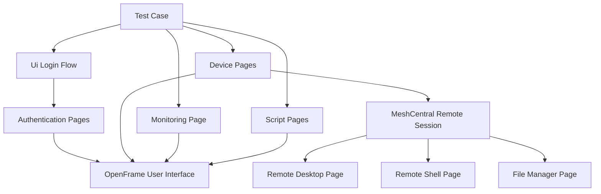
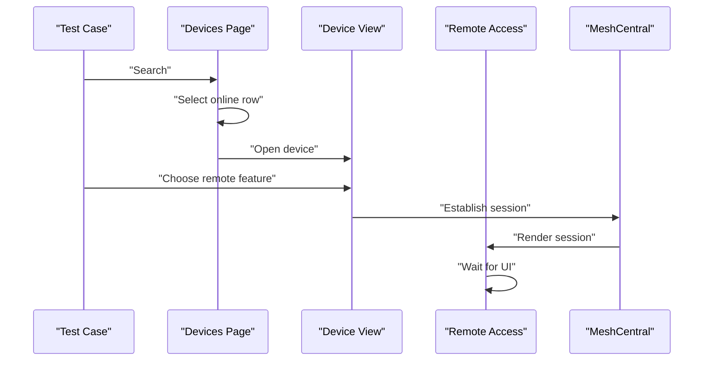
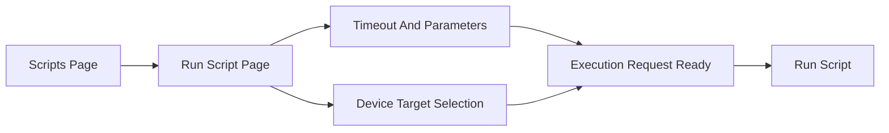

# Ui Pages

Ui Pages is the Playwright page-object layer supplied by the `com.openframe.oss:openframe-test-service-core` library. It runs with this repository’s OpenFrame test service and turns browser-level interactions into reusable Java APIs for authentication, device management, remote access, monitoring, and scripts. Each object owns a Playwright `Page`, centralizes selectors and waits, and exposes intention-revealing actions and assertions rather than requiring tests to depend on UI structure directly.

The implementation is provided by [OpenFrame OSS Library](https://github.com/flamingo-stack/openframe-oss-lib) at the pinned library source revision. It is not a frontend implementation: it is the automated-test boundary for the frontend.

## Responsibilities

- Model user-visible workflows as page objects, locators, state readers, and actions.
- Scope selectors to stable semantic anchors such as headings, roles, placeholders, routes, and menu labels where possible.
- Isolate known UI and infrastructure variability, including portalled Radix menus, asynchronous lists, remote MeshCentral sessions, and approval gates.
- Return the next page object after route-changing actions so tests can compose a workflow without re-querying browser state.
- Produce actionable failures: device lookup distinguishes a missing device from one present in a non-online state, and remote-access failure messages identify a declined or disabled session.

## Architecture Overview

The page-object classes form an adapter between test cases and the rendered OpenFrame user interface. They are used alongside the sibling Ui Flow module’s login orchestration, while this module owns page-specific interaction mechanics.

## Page Groups

### Authentication

[AuthMethodPage](https://github.com/flamingo-stack/openframe-oss-lib/blob/7a766f00e4f58b5d89db007b878ac8d6e0c344f4/openframe-test-service-core/src/main/java/com/openframe/test/pages/AuthMethodPage.java) represents the authentication-method picker at `/auth/login`. It exposes OpenFrame, Google, and Microsoft provider buttons. Selecting OpenFrame waits for the SSO credential route and returns `SsoLoginPage`.

[SsoLoginPage](https://github.com/flamingo-stack/openframe-oss-lib/blob/7a766f00e4f58b5d89db007b878ac8d6e0c344f4/openframe-test-service-core/src/main/java/com/openframe/test/pages/SsoLoginPage.java) models the server-rendered `/sas/login` form. It uses stable form identifiers for credentials and submission, retains the failed-login predicate, and returns the dashboard page after a successful redirect.

### Devices And Installation

[DevicesPage](https://github.com/flamingo-stack/openframe-oss-lib/blob/7a766f00e4f58b5d89db007b878ac8d6e0c344f4/openframe-test-service-core/src/main/java/com/openframe/test/pages/DevicesPage.java) covers the device inventory: table and grid presentation, search, tag filters, result counts, context menus, and device navigation. Its online-aware opener filters duplicate hostnames by the exact `ONLINE` badge before proceeding, which avoids stale re-registration records.

[NewDevicePage](https://github.com/flamingo-stack/openframe-oss-lib/blob/7a766f00e4f58b5d89db007b878ac8d6e0c344f4/openframe-test-service-core/src/main/java/com/openframe/test/pages/NewDevicePage.java) supports installer-command generation. It selects an organization and supported platform, reads or copies the generated command, adds command arguments, and reads antivirus exclusion paths.

[DeviceDetailsPage](https://github.com/flamingo-stack/openframe-oss-lib/blob/7a766f00e4f58b5d89db007b878ac8d6e0c344f4/openframe-test-service-core/src/main/java/com/openframe/test/pages/DeviceDetailsPage.java) is the device workflow hub. It reads header and metadata fields, switches tabs, inspects agent status, opens action menus, and launches remote desktop, shell, and file-manager sessions. It retries a timed-out MeshCentral session once, returning to the original device URL between attempts; application assertions remain strict after the session has opened.

### Remote Access

[RemoteDesktopPage](https://github.com/flamingo-stack/openframe-oss-lib/blob/7a766f00e4f58b5d89db007b878ac8d6e0c344f4/openframe-test-service-core/src/main/java/com/openframe/test/pages/RemoteDesktopPage.java) validates the remote-desktop route, canvas visibility and dimensions, header controls, and visible desktop pixels. In environments where approval is enabled, it detects and clears the test approval gate, or fails with the gate’s explicit refusal reason.

[RemoteShellPage](https://github.com/flamingo-stack/openframe-oss-lib/blob/7a766f00e4f58b5d89db007b878ac8d6e0c344f4/openframe-test-service-core/src/main/java/com/openframe/test/pages/RemoteShellPage.java) drives xterm.js through its terminal input proxy and reads output as a single snapshot from the terminal rows. Snapshot reading avoids a race with xterm row recycling during repaint or reconnect.

[FileManagerPage](https://github.com/flamingo-stack/openframe-oss-lib/blob/7a766f00e4f58b5d89db007b878ac8d6e0c344f4/openframe-test-service-core/src/main/java/com/openframe/test/pages/FileManagerPage.java) models remote browsing: breadcrumbs, search, toolbar actions, file upload, selection, folder navigation, and row context menus. Its nonblocking loaded check supports polling while a remote listing is still arriving.

### Monitoring And Scripts

[MonitoringPage](https://github.com/flamingo-stack/openframe-oss-lib/blob/7a766f00e4f58b5d89db007b878ac8d6e0c344f4/openframe-test-service-core/src/main/java/com/openframe/test/pages/MonitoringPage.java) provides navigation between Policies and Queries, policy metrics, policy searches, row actions, and query empty-state assertions. Policy-status reads wait for the target row, rather than treating a momentarily empty asynchronous list as an absent policy.

[ScriptsPage](https://github.com/flamingo-stack/openframe-oss-lib/blob/7a766f00e4f58b5d89db007b878ac8d6e0c344f4/openframe-test-service-core/src/main/java/com/openframe/test/pages/ScriptsPage.java) covers the scripts list and schedules tab. It supports search, filtering by shell, operating system, or category, menu-driven script actions, script execution entry, and schedule editing.

[RunScriptPage](https://github.com/flamingo-stack/openframe-oss-lib/blob/7a766f00e4f58b5d89db007b878ac8d6e0c344f4/openframe-test-service-core/src/main/java/com/openframe/test/pages/RunScriptPage.java) configures an execution request: timeout, arguments, environment variables, organization filtering, target-device selection, and final submission. The run action remains disabled until at least one target device is selected.

## Interaction Flows

### Device To Remote Session

For remote desktop, usability requires a visible canvas and, when configured, a resolved approval gate. For PowerShell, the details page waits for the `PS ` prompt. For file management, it waits until the first remote-listing name is present.

### Script Execution Setup

`RunScriptPage` maintains separate index handling for script arguments and environment variables because both use key inputs but appear in distinct logical sections. The page object also exposes selected and visible device names, allowing tests to assert the target set before submission.

## Selector And Waiting Strategy

Ui Pages deliberately combines semantic selectors with tightly scoped structural selectors where the UI does not provide accessible names. Examples include provider-button text, input placeholders, `aria-label` values, `role` attributes, route predicates, and a direct-child column mapping for policy rows.

Portalled menus are addressed as `div[role='menu']`, not a generic menu-role selector. This excludes permanent media-player menu elements in the application shell and preserves Playwright strictness. Loaded predicates used with `waitForCondition` avoid auto-waiting reads: they check whether nodes currently exist before extracting text, so a normal loading interval polls rather than failing each poll with a long selector timeout.

## Maintenance Considerations

- Treat selectors as contracts with the rendered user interface. When markup changes, prefer accessible labels, stable routes, and component-level semantics over layout-dependent utility classes.
- Preserve explicit waits at asynchronous boundaries: list rendering, single-page application navigation, remote session startup, and modal lifecycle transitions.
- Keep retry scope narrow. The device-details MeshCentral retry covers connection establishment only; it must not mask a failing feature assertion.
- Update page objects together with UI copy changes. For example, the authentication selector intentionally matches `Continue with OpenFrame`, and context-menu text is part of the current test contract.
- The page objects belong to the OpenFrame OSS Library artifact version `7.0.11`, consumed by this repository. Changes to their behavior should be released through that library before this repository can consume them.
