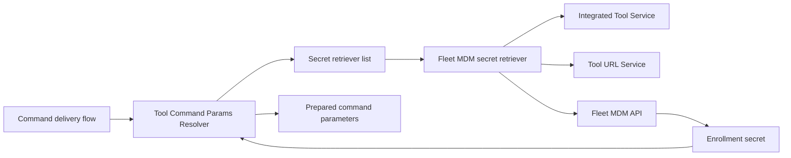
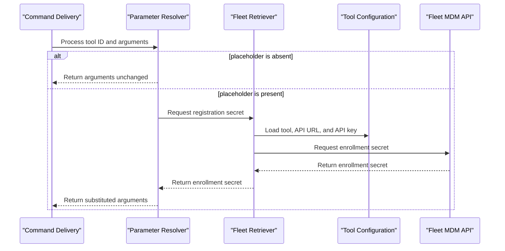
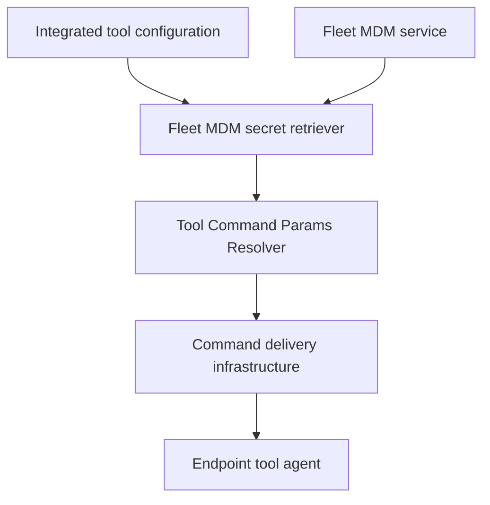

# Tool Agent Nats Installation

Tool Agent Nats Installation is an OpenFrame OSS Library integration module that resolves tool-launch command arguments before they are delivered to an endpoint tool agent. Its focused responsibility is to substitute the `${server.registrationSecret}` placeholder with a registration secret for the target integrated tool.

The module is activated only when `openframe.integration.tool.enabled` is `true`. In the supplied implementation, the supported tool is Fleet MDM, identified by `fleetmdm-server`. Despite the module name, these components do not establish NATS connections or subscriptions. They prepare sensitive command parameters; surrounding delivery infrastructure transports the resulting command.

## Scope and Source

This repository consumes this implementation from the OpenFrame OSS Library artifact `com.openframe.oss:openframe-tool-agent-nats-installation` at version `7.0.11`.

- [Tool Command Params Resolver source](https://github.com/flamingo-stack/openframe-oss-lib/blob/7a766f00e4f58b5d89db007b878ac8d6e0c344f4/openframe-tool-agent-nats-installation/src/main/java/com/openframe/data/service/ToolCommandParamsResolver.java)
- [Fleet MDM Agent Registration Secret Retriever source](https://github.com/flamingo-stack/openframe-oss-lib/blob/7a766f00e4f58b5d89db007b878ac8d6e0c344f4/openframe-tool-agent-nats-installation/src/main/java/com/openframe/data/service/secretretriver/FleetMdmAgentRegistrationSecretRetriever.java)

## Architecture

The module uses a resolver-and-provider design. `ToolCommandParamsResolver` detects placeholders and selects a `ToolAgentRegistrationSecretRetriever` whose declared tool identifier equals the requested tool identifier. `FleetMdmAgentRegistrationSecretRetriever` is the Fleet MDM provider. It loads the integrated tool and its API URL, creates a Fleet MDM SDK client, and obtains the enrollment secret.

## Core Components

### Tool Command Params Resolver

`ToolCommandParamsResolver` is the command-argument transformation boundary.

- Its `process(toolId, commandArgs)` method preserves a `null` argument list and otherwise maps every entry through internal argument processing.
- A `null` argument entry remains `null`.
- An argument without `${server.registrationSecret}` is returned unchanged.
- An argument containing the placeholder replaces every occurrence with the selected retriever's secret.
- Retriever selection is exact: the requested `toolId` must equal `getToolId()` on a registered `ToolAgentRegistrationSecretRetriever`.
- If no retriever matches, processing fails with `IllegalStateException`; it never silently emits a command containing an unresolved secret placeholder.

The component is a Spring `@Component`, constructed with the list of retrievers available in the application context. Its conditional configuration means it is absent when tool integration is disabled.

### Fleet MDM Agent Registration Secret Retriever

`FleetMdmAgentRegistrationSecretRetriever` implements the retriever contract for tool ID `fleetmdm-server`. Its `getSecret()` operation performs live retrieval rather than storing the enrollment secret locally.

1. It resolves the Fleet MDM integrated-tool definition through `IntegratedToolService`.
2. It obtains the API `ToolUrl` through `ToolUrlService` and combines its URL and port into the Fleet API address.
3. It reads the configured API key from the integrated tool credentials.
4. It creates `FleetMdmClient` with the address, API token, and tenant identifier, then calls `getEnrollSecret()`.
5. It logs successful retrieval and returns the secret to the resolver.

The retriever wraps lookup, configuration, client-construction, and Fleet API failures in `IllegalStateException`. A missing integrated tool, missing API URL, invalid tenant configuration, or Fleet request failure therefore prevents command preparation rather than sending an incomplete registration command.

## Command Preparation Flow

## Configuration and Tenant Validation

| Setting | Role | Default behavior |
|---|---|---|
| `openframe.integration.tool.enabled` | Enables both Spring components when set to `true`. | Components are not registered unless explicitly enabled. |
| `TENANT_ID` | Supplies the tenant identifier passed to Fleet MDM. | Defaults to an empty value. |
| `openframe.fleet.multi-tenancy.enabled` | Indicates whether Fleet MDM multi-tenancy is enabled. | Defaults to `false`. |

At bean initialization, the Fleet MDM retriever invokes `FleetTenantHeader.validate(fleetMultiTenancyEnabled, tenantId)`. This verifies tenant configuration before secret retrieval begins. The validation occurs during application initialization for this component, not only when the first command needs a secret.

## Operational Characteristics

- **Just-in-time secret retrieval:** The enrollment secret is requested only when a command argument contains the registered placeholder.
- **Targeted substitution:** Only Fleet MDM commands select the Fleet MDM retriever. Other tool identifiers require their own registered retriever implementation.
- **No mutation of caller input:** The resolver creates its output through a stream mapping operation rather than modifying the supplied list.
- **Failure is explicit:** Missing configuration or an unavailable Fleet MDM API propagates as an exception and blocks the affected command preparation.
- **Secret handling:** The implementation logs successful retrieval but does not log the enrollment-secret value. Callers should similarly avoid logging the prepared command arguments after substitution.

## System Context

Tool Agent Nats Installation bridges server-side integrated-tool configuration and an endpoint agent's tool installation command. The configuration services supply the Fleet MDM endpoint and credentials; this module derives the runtime enrollment secret; and the command-delivery layer uses the prepared parameters. Fleet MDM client behavior is supplied by the OpenFrame OSS Library `com.openframe.oss:fleetmdm` dependency.

## Maintenance Notes

When adding support for another integrated tool, implement and register a `ToolAgentRegistrationSecretRetriever` that returns that tool's identifier and secret. The resolver will select it automatically through exact identifier matching. Keep provider-specific configuration validation close to the provider, and ensure errors remain explicit so installation commands never proceed with an unresolved registration secret.